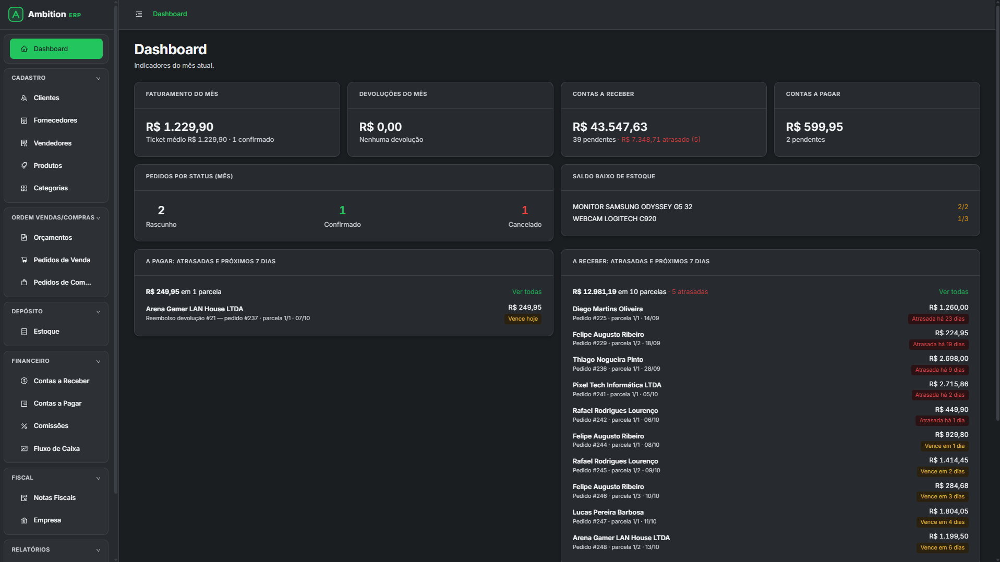
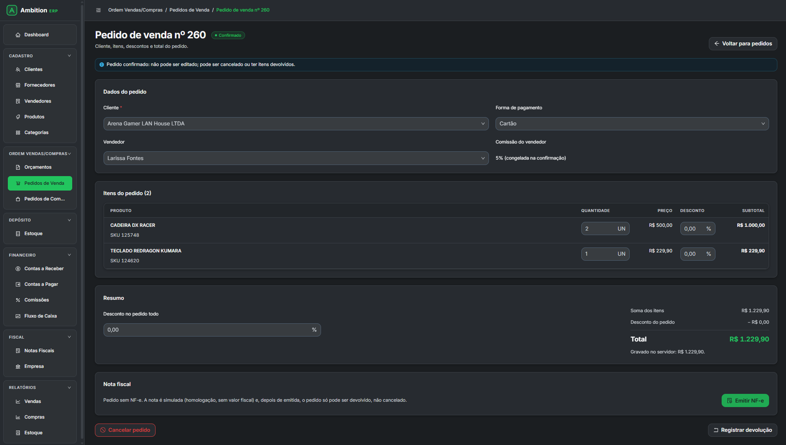
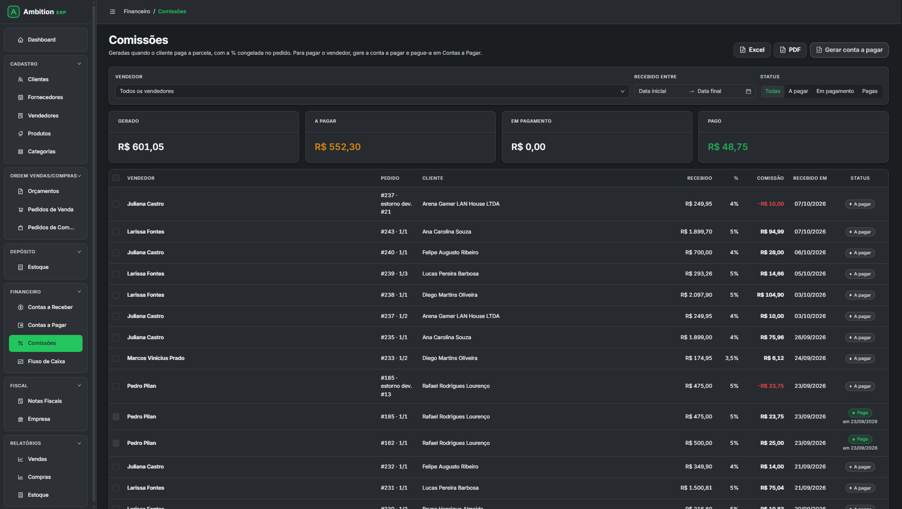
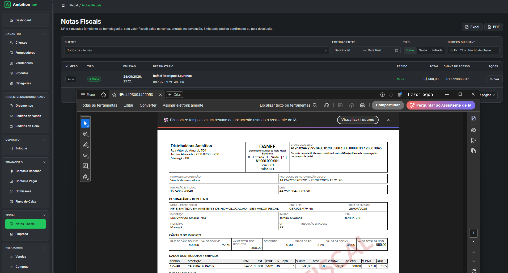

# Ambition ERP

ERP comercial para pequenas e médias empresas, desenvolvido como projeto de portfólio. Cobre o ciclo completo **orçamento → venda → estoque → financeiro → nota fiscal**, com módulos integrados e tema escuro próprio.




## Destaques

- **Módulos integrados:** confirmar uma venda baixa o estoque, gera as parcelas a receber e, quando o cliente paga, a comissão do vendedor. Cada operação grava os seus reflexos numa única transação.
- **Regras no servidor:** totais, descontos, impostos e parcelas são calculados na API; o front nunca é a fonte da verdade.
- **NF-e simulada:** impostos por item, chave de acesso com dígito verificador, XML no layout 4.00 e DANFE em PDF.
- **Relatórios** com exportação para Excel e PDF.
- **Testado:** 163 testes unitários (xUnit), roteiros de ponta a ponta na API e testes de tela com Playwright.

## Telas

| Pedido de venda | Comissões | Notas fiscais |
|---|---|---|
|  |  |  |

## Módulos

| Área | Módulos |
|---|---|
| **Cadastro** | Clientes (CPF/CNPJ, inclusive alfanumérico), Fornecedores, Vendedores, Produtos, Categorias |
| **Vendas e compras** | Orçamentos (validade e PDF), Pedidos de Venda, Pedidos de Compra, Devolução de venda |
| **Depósito** | Estoque por movimentações, com baixa e estorno automáticos e alerta de estoque mínimo |
| **Financeiro** | Contas a Receber, Contas a Pagar (compra, comissão, avulsa, reembolso), Comissões, Fluxo de Caixa |
| **Fiscal** | Dados do emitente e NF-e de venda e de devolução (ICMS/PIS/COFINS, chave, XML, DANFE) |
| **Relatórios** | Vendas, Compras e Estoque, em Excel e PDF |
| **Dashboard** | Faturamento, devoluções, contas a receber e a pagar, estoque baixo e vencimentos dos próximos 7 dias |

## Como funciona

```
Orçamento ──gerar pedido──▶ Pedido de venda (rascunho)
                                   │ confirmar (pagamento, vendedor, parcelas)
                                   ▼
            ┌──────────────── Pedido confirmado ────────────────┐
            ▼                      ▼                            ▼
   Saída no estoque     Parcelas em Contas a Receber      NF-e (opcional)
                                   │ cliente paga
                                   ▼
                       Comissão do vendedor ──▶ Conta a pagar ao vendedor
```

- **Venda:** preço e % de comissão ficam congelados no pedido. Sem saldo em estoque, a confirmação é recusada. Cancelar devolve o estoque e cancela as parcelas pendentes.
- **Compra:** confirmar dá entrada no estoque, atualiza o custo do produto e gera as parcelas em Contas a Pagar.
- **Devolução:** parcial ou total. O produto volta ao estoque (ou é baixado como perda), as parcelas pendentes são abatidas, o valor já pago vira reembolso e a comissão é estornada.
- **Fluxo de caixa:** junta o realizado com o previsto e mostra o saldo acumulado por dia ou por mês.

> A NF-e é **de demonstração**: ambiente de homologação, sem assinatura digital e sem envio à SEFAZ. O DANFE sai marcado como "SEM VALOR FISCAL".

## Stack

| Camada | Tecnologias |
|---|---|
| Back-end | ASP.NET Core Web API (.NET 10), Entity Framework Core + Npgsql, Swagger |
| Banco | PostgreSQL 18 (Docker) |
| Front-end | React 19 + TypeScript, Vite, Ant Design 6, TanStack Query, React Hook Form + Zod |
| Arquivos | ClosedXML (Excel) e QuestPDF (relatórios, orçamentos e DANFE) |
| Testes | xUnit e Playwright |

Arquitetura em camadas: **Controllers** cuidam só do HTTP, **Services** concentram as regras de negócio e as transações, **DTOs** separam o contrato da API das entidades e as **migrations** do EF Core versionam o banco.

## Como rodar

Pré-requisitos: [.NET SDK 10](https://dotnet.microsoft.com/download), [Node.js 20+](https://nodejs.org/) e [Docker Desktop](https://www.docker.com/products/docker-desktop/).

```powershell
# 1. Banco: crie o .env (troque a senha), suba o PostgreSQL e aplique as migrations
Copy-Item .env.example .env
docker compose up -d
dotnet tool restore
dotnet user-secrets set "ConnectionStrings:ErpPortfolio" "Host=localhost;Port=5433;Database=erp_portfolio_db;Username=erp_user;Password=SENHA_DO_ENV" --project backend/ErpPortfolio.Api
dotnet ef database update --project backend/ErpPortfolio.Api

# 2. API (Swagger em http://localhost:5065/swagger)
dotnet run --project backend/ErpPortfolio.Api --launch-profile http

# 3. Front, em outro terminal (http://localhost:5180)
cd frontend/erp-portfolio-web
npm install
npm run dev

# Testes unitários
dotnet test backend/ErpPortfolio.Tests
```

Passo a passo detalhado e solução de problemas no [guia de desenvolvimento](docs/desenvolvimento.md).

## Documentação

| Documento | Conteúdo |
|---|---|
| [Funcionalidades](docs/funcionalidades.md) | Regras e comportamento de cada módulo |
| [API](docs/api.md) | Rotas, filtros, respostas, erros e regras de validação |
| [Banco de dados](docs/banco-de-dados.md) | Tabelas, colunas, índices e restrições |
| [Decisões técnicas](docs/decisoes-tecnicas.md) | O porquê de cada escolha de arquitetura |
| [Testes](docs/testes.md) | Cenários testados em cada módulo, na API e na tela |
| [Guia de desenvolvimento](docs/desenvolvimento.md) | Instalação passo a passo, tema visual, estrutura de pastas, padrões de código e solução de problemas |
| [Memória do projeto](docs/memoria-do-projeto.md) | Histórico das etapas, versões exatas da stack e processo de trabalho |

## Roadmap

Etapas 1 a 16 concluídas. Próximas: **login e permissões**, categorias de despesa, inventário e deploy. Lista completa em [próximas etapas](docs/desenvolvimento.md#próximas-etapas).

---

Desenvolvido por **Rafael Lourenço**.
